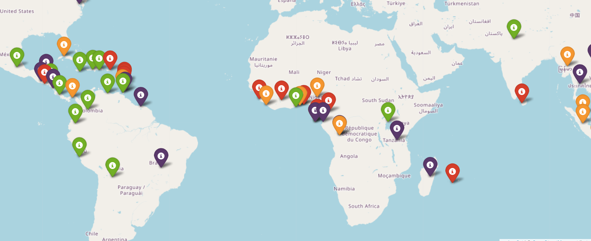

```python

```

\begin{center}
\begin{huge}
DATA203 Foundational Python (Prof. Maull) / Fall 2026 / HW3
\end{huge}
\end{center}

| Points <br/>Possible | Due Date | Time Commitment <br/>(estimated) |
|:---------------:|:--------:|:---------------:|
| 20 | Thursday, October 29 @ midnight | _up to_ 15 hours |


* **GRADING RUBRIC:** Grading will be aligned with the completeness of the objectives.

	Your solution is evaluated on:

	1. whether your solution correctly answers the question(s) being asked,
	2. using the Python language as required in the question(s).

	Your solution is **NOT** evaluated on:

	1. the elegant use of Python,
	2. optimal or high performance Python code unless _explicitly noted_ in the question(s).

* **INDEPENDENT WORK:** Copying, cheating, plagiarism  and academic dishonesty _are not tolerated_ by University or course policy.  Please see the syllabus for the full departmental and University statement on the academic code of honor.

* **LARGE LANGUAGE MODEL (LLM) / ARTIFICIAL INTELLIGENCE/LLM (AI) POLICY:**

	LLMs / Artificial Intelligence technologies such as 
	Claude, Gemini, Grok, etc are **NOT**
	to be used in the production of your final homework solutions.

	Such technologies offer important capabilities for your 
	_learning_ journey, but they are not appropriate in
	this course for the production of your solutions.

	You _may_ use such technologies to _learn_ more about
	specific Python concepts or to help clarify your
	knowledge about the details of Python syntax, modules, 
	techniques or other programming principles.

	Final solutions found to be the _partial or entire product_ of 
	LLM/AI use **will receive 0 points**, without clarification,
	resubmission or correction.


## OBJECTIVES
* PART 1: Convert unstructured data to structured data.

* PART 2: Use the data to produce rating of chocolates by country.

## WHAT TO TURN IN
You will enjoy the highest benefits of the starter notebook
if you clone the HW Github repository from your Jupyter Hub
terminal with the command:

```bash
  git clone https://github.com/kmhuads/f26_data203.git
``` 

This will ensure you have the most updated files and starter 
notebook.

Once you have cloned the repository, you can edit the
starter notebook with your solution code.

When you are done with your work, it will be best to zip
your `hw2` folder and all sub-folders with the terminal command
(one level outside your notebook folder):

``` bash
  zip -r data203_hw3_maull.zip ./hw3
 ```

This will produce the file with all necessary supporting files
(notebooks, data output, etc.) 
then
download it from the Jupyter Hub to your local machine, 
then upload the `.zip` to Teams.

If you are confused on how to do this, please ask, 
or visit one of the many tutorials
on the basics of using zip in Linux.  

If you choose not to use the provided notebook, you will still need to turn in a
`.ipynb` Jupyter Notebook and corresponding files according to the instructions in
this homework.


## ASSIGNMENT TASKS
### (75%) PART 1: Convert unstructured data to structured data. 


**ASSIGNMENT BACKGROUND**

In our previous assignments we
learned about YAML and JSON files
for storing data.

We did not explicitly say what kind
of data was in the file, but instead
we used Python objects like
lists and dictionaries to easily
store the data into formats which were 
compatible and interchangeable. The Python
objects dictated what was in the data. We could, 
for example, load a JSON
file into a Python dictionary or save a 
Python dictionary into a JSON file.

The dictionary is what is called 
a _structured_ format -- that is
to say it's components can be 
easily identified (or inferred)
and more importantly, that it is easily consumable
by a machine (your Python code).

You might ask, if these are structure
then what is _unstructured_?  Unstructured
data differs fundamentally in that
first you will not easily understand the
format or components of the data without
deeper prior knowledge.  For example, 
most written documents (letters, manuals,
publications) are _unstructured_.  They 
are not easily understood without prerequisite
knowledge -- for example, if you do not know Spanish, you 
will have a hard time reading Spanish words or
even understanding the meaning, structure and 
intent of the sentences.

Machines are equally clueless with unstructured data, 
except when we use
very sophisticated software such as the LLMs (Large Language Models) in 
ChatGPT, Claude, Gemini and others, but
know that getting a machine to process this
unstructured data in the way current generation
LLMs do, is a very heavy lift and
requires tremendous amounts of resources to accomplish.

You might also wonder why unstructured data is such 
a big deal or why we are concerned about it here.
Take a look at some remarkable statistics about
the state of structured and 
unstructured data in today's data landscape.
According to IDC's (International Data Corp) [2024 
report](https://techcontentwave.com/files/1763389937_64b594fd4f7f5607256a.pdf)
_Worldwide Global DataSphere Structured and Unstructured Data Forecast, 2024–2028_:     


1. By the end of 2026, unstructured data is expected to account for nearly 88% of global data generation.
2. Unstructured data CAGR (compound annual growth rate) is projected to be 21.4% in the 
   five year period between 2023-2028, topping nearly 400 zettabytes (ZB) of data.
3. By 2028, structured data is still only expected
   to make up less than 20% of all 
   data generated.

With statistics like these -- a well positioned data scientist
is one who at least
understands the landscape, processes and
tools of structured
and unstructured data.  As a side note, you might be scratching
your head on how much data a "zettabyte" is. Your laptop
computer may have a total of 512GB of storage on its hard drive.  A 
zettabyte is 2 _billion_ of such laptop hard drives **filled**.

**DATASET**

We are going to warm up first with some fun data
which will please the chocolate
lovers among us (yes, including myself with 
a strong preference for dark, >70% cacao). A few
years ago, I found a wonderful website
called _Flavors of Cacao_ (FoC) and on
that website is a page of over 2800
chocolate bars which have been taste 
tested and rated by the Manhattan Chocolate 
Society.  Visit the full website and ratings page:

* [Flavors of Cacao - main site](https://flavorsofcacao.com/)
* [FoC / MCS Chocolate Bar Database and Ratings](https://flavorsofcacao.com/chocolate_database.html)  

You may notice something curious, though.  The database ratings
page
is just one big web table and for all intents and purposes
is difficult to filter, sort or search -- unless
you just want to CTRL-F your way to a slow time
hunting. This
is a shame, but also an amazing learning
opportunity as this is a _prime_ example
of unstructured data -- yes, you could argue 
it is semi-structured since it is _presented_
as a table, but it is otherwise not 
easily consumed by a machine. We are going 
to convert this page into
something more useful -- a CSV file. 

**&#167; Task:**  **1.0 Convert the _FoC_ table to a CSV file.**

You have, no doubt, come across CSV files at
least once in your lifetime so far.  CSV
stands for "Comma Separated Values" and
like you probably remember, this file
usually contains a bunch of data like this example:

```bash
height (cm),weight (kg),age
165,60,30
175,75,45
180,80,50
155,55,25
170,65,35
```

You probably used Excel to load the file and went
about the task of doing something useful with it.
This is an example of structured data.  You also have
hints and clues about what each number means 
and luckily the first line of the file includes
the units of those numbers (cm, kg and we'll assume
age is in years). Each column is organized specifically
around a data variable and each row contains a single
data point across those variables.  CSV files 
can be large and are valuable for storing many
types of data that can be organized in a table.

We are going to convert the chocolate bars table on the 
FoC page
to a CSV and to do so we are going to need to import a 
very special library called [BeautifulSoup](https://beautiful-soup-4.readthedocs.io/en/latest/) 
to do it.  Please load the starter notebook
for this assignment to learn how to use it.

Your task is to convert the FoC ratings table to a 
CSV file and store the data in a file 
within the `data/` folder called
`foc_chocodb.csv`.  

Here are the specifics:

1. The file will contain 10 columns:

* REF
* Company (Manufacturer)
* Company Location
* Review Date
* Country of Bean Origin
* Specific Bean Origin or Bar Name
* Cocoa Percent
* Ingredients
* Most Memorable Characteristics
* Rating

2. The file will use comma `,` as the column (field)
delimiter.

3. All fields (columns) in the final output will be surrounded by the quote character `"`.  If there is a `"` 
   character in a field, replace it with two quotes or `""`.  For example,
   if you have something like `Fine "Cacao" Corp` in a field, your
   output will be `"Fine ""Cacao"" Corp"`. 

4. The file will have 2842 rows of data represented by the entire table.

5. The file will be stored in the `data/` folder of your notebook homework
    and named `foc_chocodb.csv`.


**&#167; Task:**  **1.1 Create a CSV file with just the chocolates with `Rating` equal to 
  or higher than 3.9.**

You will loop over all the data and check just the `Rating` and 
store only those rows where the `Rating` is greater than
or equal to 3.9.  Name the file `data/foc_chocodb_top_rated.csv`.

You will find and use the Python `csv` module useful! Read the documentation
about it here.  You may **not** import any other libraries in this part:

* [Python `csv` module documentation](https://docs.python.org/3/library/csv.html)

You may use the [`csv.reader()`](https://docs.python.org/3/library/csv.html#csv.reader) function, just remember
that the `Country of Bean Origin` is index 4 and 
`Rating` is index 9 (or -1).  You can also use
[`csv.DictReader()`](https://docs.python.org/3/library/csv.html#csv.reader) 
but you will still need to store the data in the CSV file.


**&#167; Task:**  **1.2 Write a function that reads the file and returns the rows 
  of countries as a string given the input parameters.**

Your function will take up to five parameters, a filename _fname_, 
a minimum rating _rating_min_, a maximum rating _rating_max_ 
and a header indicator _header_.

Your code will open the file, scan the `Country of Bean Origin`
column for the _country_ string and/or `Rating` column
for rating and return the lines
that match the values of the input parameters. 

You should normalize the country using lowercase in both
the file and the input.


**FUNCTION SPECIFICATION**

_function_ **NAME**: `filter_db_csv`

_function_ **INPUT**: 

  - _fname_ &#8594; the string for the filename containing the CSV Data
  - _country_ &#8594; the string containing the country name to filter on
  - _rating_min_ (optional; default 0) &#8594; a float  containing the _minimum_ rating
  - _rating_max_ (optional; default 4) &#8594; a float  containing the _maximum_ rating
  - _header_  (optional; default `True`) &#8594; `True` if the output is expected to include the header, otherwise `False`

_function_ **OUTPUT**:
  
  - a string which contains the header (first line of the CSV file With
  the column names)
  - all lines in the CSV input file _fname_ which match the parameters given
  - remember the input _country_ uses the `Country of Bean Origin` column
  - the input _rating_min_ and _rating_max_ use the `Rating` column
  - each line of data must have a terminating newline `\n`
  
_Code Example_:

```python
  filter_db_csv_str("foc_chocodb.csv", country="uganda") 
```

_Example Output_:

**NOTE:** the output has been reduced so it can be more readable here, 
but you will need to emit _all_ columns and data.

```csv
  "REF","Company (Manufacturer)",..,"Country of Bean Origin","Specific Bean Origin or Bar Name",...,"Rating"
  "2546","5150",...,"Uganda","Semuliki Forest, batch 1",...,"3.25"
  "2832","Bonnat",...,"Uganda","Uganda, Geant des Brames",...,"3.25"
  ... 
```


**&#167; Task:**  **1.3 Use your function to produce a file with just the parameters given.** 

1. Produce a new file `data/foc_chocodb_pancubrabel.csv` that includes **only** the following countries:

  * Panama
  * Cuba
  * Brazil
  * Belize


2. Produce a new file with only those chocolates with `Rating` less than 2. Name the file
`data/foc_chocodb_low_tier.csv`.

3. Produce a new file with only those chocolates from _Brazil_ with a `Rating` 
greater than or equal to 3.5.  Name the file `data/foc_chocodb_brazil_high_tier.csv`.

Don't overthink it -- remember that you can use `write()`
to write data to a file, given a string.


**&#167; Task:**  **1.4 Use your function to filter on the same input but output the data list of dictionaries.** 

You will do the same as before, but the return result
will be a list of dictionaries.

You may use the Python `csv.DictReader()` function to 
save a tremendous amount of time.

**FUNCTION SPECIFICATION**

_function_ **NAME**: `filter_db_dict`

_function_ **INPUT**: 

  - _fname_ &#8594; the string for the filename containing the CSV Data
  - _country_ &#8594; the string containing the country name to filter on
  - _rating_min_ (optional; default 0) &#8594; a float  containing the _minimum_ rating
  - _rating_max_ (optional; default 4) &#8594; a float  containing the _maximum_ rating

_function_ **OUTPUT**:
  
  - a list of dictionaries
  - each entry in the list is a dictionary which contains the header (first line of the CSV file With
  the column names) as the key and the corresponding value
  - all outputs come from the input file _fname_ which match the parameters given
  - remember the input _country_ uses the `Country of Bean Origin` column
  - the input _rating_min_ and _rating_max_ use the `Rating` column
  
  _Code Example_:

  ```python
    filter_db_dict("foc_chocodb.csv", country="uganda") 
  ```

  _Example Output_:

  ```python
    [{'REF': '2546',
    'Company (Manufacturer)': '5150',
    'Company Location': 'U.S.A.',
    'Review Date': '2021',
    'Country of Bean Origin': 'Uganda',
    'Specific Bean Origin or Bar Name': 'Semuliki Forest, batch 1',
    'Cocoa Percent': '80%',
    'Ingredients': '3- B,S,C',
    'Most Memorable Characteristics': 'mildly bitter, basic cocoa, fatty',
    'Rating': '3.25'},
    ...
    ]
 ```


### (25%) PART 2: Use the data to produce rating of chocolates by country. 


We are almost there.  What's left is to combine
our newly acquired knowledge about
chocolates to  interactive visualizations.

  

**&#167; Task:**  **2.0 Create a dictionary of the average chocolate ratings by country.**

  Use your previous function `filter_db_dict()`
  to produce the dataset for the
  following 20 countries:

  - Congo, Jamaica, Panama, India, Indonesia, Liberia, Honduras, Sao Tome & Principe, Costa Rica, Tanzania, Dominican Republic, Malaysia, Papua New Guinea, Haiti, China, Nicaragua, Peru, Taiwan, Congo, India
  
  You will output a dictionary of the form:

  ```python
  {
    'Haiti': 3.217,
    'Gabon': 3.25, 
    ...
  }
  ```

  You may write a function for 
  this or you can run it in a cell
  as long as you store the output
  so it can be used in the next step.


**&#167; Task:**  **2.1 Use the dictionary from Task 2.0 to build an interactive map.**

  We will use a visualization
  tool called Folium to display
  the countries, ratings and 
  a color coded marker.

  First, take a look at Folium
  and see how cool it is:


  * [Folium Python module](https://python-visualization.github.io/folium/latest/)

  You will need to install Folium by running:

  ```python
  !pip install folium
  ```

Your map will look something like:



To produce this map, look at the scaffolding
code in the starter notebook.

You will need to load the file `data/country_locations.csv`
and use the latitude and longitude data
to place the markers correctly on the map.  To do 
this, you may want to load it into
a structure with a key on the 
country, so you can get the latitude
and longitude.

Here are the requirements for your map:

1. An average rating under 3 should
be colored _red_;
2. color the markers _orange_ when the average
rating is between 2.99 and 3.14;
3. color the markers _green_ when the 
average rating is between 3.15 and 3.23;
4. color the markers _purple_ when the
average rating is greater than 3.24.


